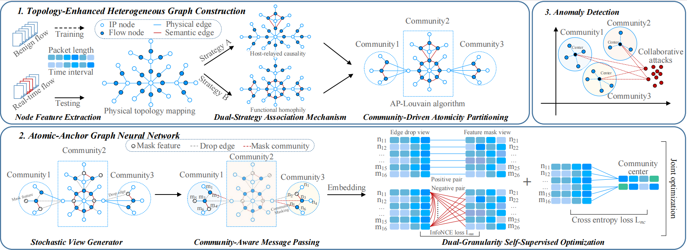

# Atomic-Anchor

<p align="center">
  
</p>

## Abstract

Stealthy network attacks increasingly evade detection by mimicking the feature distributions of benign traffic, rendering traditional point-based analysis ineffective. Although Graph Neural Networks (GNNs) possess the capability to capture relational dependencies, their indiscriminate aggregation mechanism often induces relational smearing, which sequentially leads to feature smearing that blurs the structural boundaries between legitimate flows and adversarial noise. This paper proposes Atomic-Anchor, an unsupervised framework that identifies anomalies by exploiting a fundamental structural dichotomy inherent in network topology. We observe that benign traffic naturally manifests as atomized micro-communities within specific business contexts, characterized by weak internal correlations and sparse external coupling. In contrast, coordinated malicious activities form highly cohesive aggregates due to their collaborative nature, with flows tightly coupled through functional or causal dependencies. To leverage this divergence, Atomic-Anchor introduces a community-driven GNN architecture that employs isolation masking to ensure structural purity and prevent cross-community information contamination. Furthermore, we design a dual-granularity optimization strategy that preserves intra-community diversity while driving benign representations toward stable atomic anchors in a latent manifold. Extensive experiments on 34 collaborative attack categories show that Atomic-Anchor effectively amplifies structural divergence between legitimate atoms and malicious clusters. It achieves an average Macro F1-score of 97.7% and an AUC of 99.5%, outperforming the strongest baseline by relative improvements of 10.2% and 8.7%, respectively, establishing a robust geometric baseline for detecting sophisticated, coordinated threats.

## Pipeline

1. **Dual-strategy graph construction** — causal time-window edges
   (Strategy A) and wavelet-Pearson semantic edges (Strategy B) over flow
   records (`feature_extract.py`, `graph_builder.py`).
2. **CDAP two-stage partitioning** — Stage-1 Louvain coarse communities,
   Stage-2 surgical refinement into fine semantic subgroups
   (`graph_builder.py`).
3. **A2GNN encoding** — contextual injection (CCI) + isolation masking (IIM),
   dual-granularity loss (`hcg_model.py`, `train.py`).
4. **Dual-channel detection** — Channel A: EVT/POT thresholding on embedding
   distances; Channel B: semantic-group verification (SGV) with OR fusion
   (`run_evt.py`).


## Layout

```
feature_extract.py            flow parsing + feature extraction
graph_builder.py              dual-strategy graphs + CDAP partitioning
hcg_model.py                  A2GNN model
train.py                      training loop
run_evt.py                    end-to-end training + dual-channel detection
```

## Requirements

See `requirements.txt` (Python 3.8, PyTorch 2.4.0, torch-geometric 2.6.1).

## Data

Place each dataset under `data/<dataset>/` as pickled flow records, e.g.

```
data/cicids2017/benign.pkl
data/cicids2017/<attack>.pkl
```

## Usage

```bash
# standard end-to-end run (train if no checkpoint, then detect)
python run_evt.py --dataset <name> --attack <attack_pkl> --sgv

```

Run `python run_evt.py --help` for the full parameter list (threshold
calibration, ablation switches, SGV options, seeds).

## Key References

- **Y. Mirsky, T. Doitshman, Y. Elovici, and A. Shabtai,** "Kitsune: An
  ensemble of autoencoders for online network intrusion detection,"
  *NDSS*, 2018. — online-detector baseline.
- **Z. Zhao et al.**, "Trident: A universal framework for fine-grained and
  class-incremental unknown traffic detection," *WWW*, 2024, pp. 1608–1619.
  — fine-grained traffic-detection baseline.
- **W. Zheng et al.**, "Learning to classify: A flow-based relation network
  for encrypted traffic classification," *WWW*, 2020, pp. 13–22. —
  flow-relation modeling; source of the evaluation-metric protocol.
- **A. Siffer, P.-A. Fouque, A. Termier, and C. Largouët,** "Anomaly
  detection in streams with extreme value theory," *KDD*, 2017,
  pp. 1067–1075. — EVT/POT thresholding (Channel A).
- **V. D. Blondel, J.-L. Guillaume, R. Lambiotte, and E. Lefebvre,** "Fast
  unfolding of communities in large networks," *J. Stat. Mech.: Theory and
  Experiment*, vol. 2008, no. 10, P10008, 2008. — Louvain community
  detection (CDAP Stage 1).
- **W. Hamilton, Z. Ying, and J. Leskovec,** "Inductive representation
  learning on large graphs," *NeurIPS*, vol. 30, 2017. — GNN aggregation
  backbone.
- **P. Veličković et al.**, "Deep graph infomax," *ICLR*, 2019. —
  contrastive representation learning.
- **C. Torrence and G. P. Compo,** "A practical guide to wavelet analysis,"
  *Bull. Am. Meteorol. Soc.*, vol. 79, no. 1, pp. 61–78, 1998. — wavelet
  analysis (Strategy B semantic edges).
- **Canadian Institute for Cybersecurity,** "Intrusion Detection Evaluation
  Dataset (CICIDS2017)," 2018.
  [dataset](https://www.unb.ca/cic/datasets/ids-2017.html)
- **Canadian Institute for Cybersecurity,** "Intrusion Detection Evaluation
  Dataset (ISCX Botnet 2014)," 2014.
  [dataset](https://www.unb.ca/cic/datasets/ids-2017.html)
